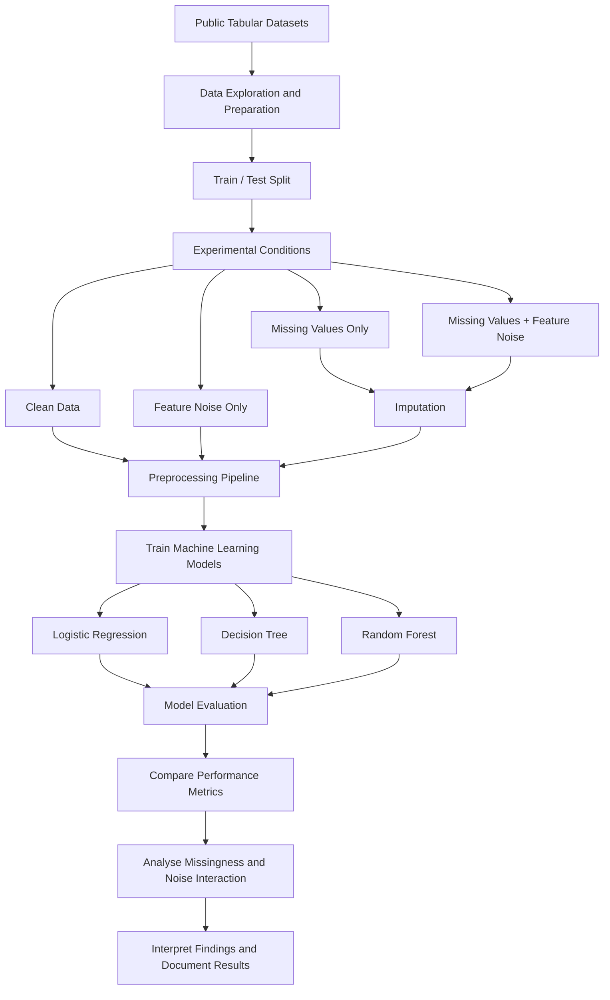
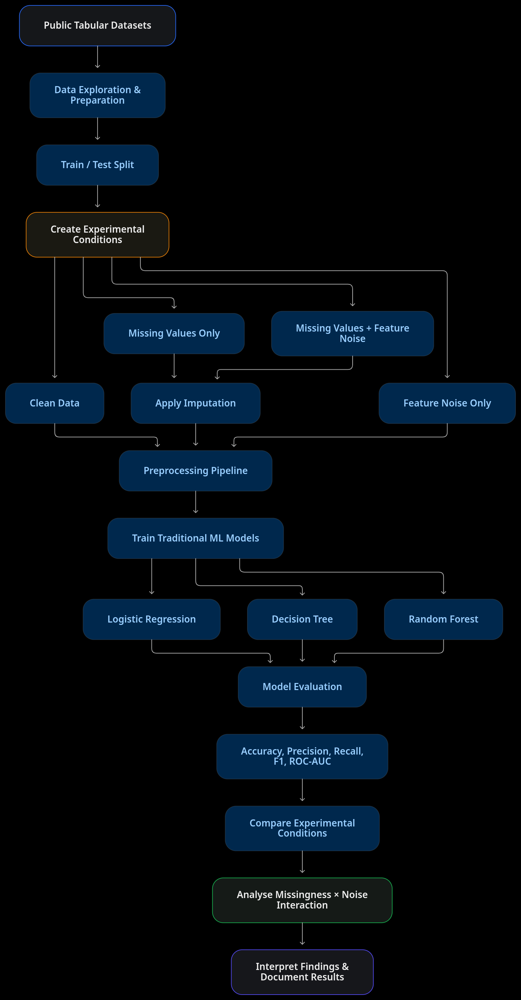

# Machine-Learning-and-Data-Quality-Research
Investigating the Impact of Missing Values and Noisy Data on Machine Learning Model Performance

## Research Workflow

This diagram illustrates the proposed experimental workflow.
The study compares clean data, missing values, feature noise,
and their combined effects on traditional machine learning models.

## Research Workflow

